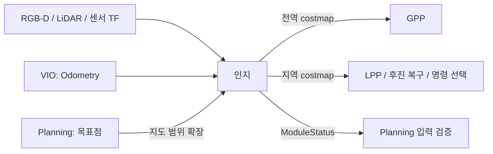

# 인지 모듈 — nomad_perception

> 인터페이스 버전 1 · 2026-10-02 · ROS 2 Jazzy

인지 담당자는 센서 관측과 VIO 위치를 같은 좌표계에 정합하고, Planning이 읽을 **전역·지역 통행 비용 지도와 인지 상태**를 제공한다. 목표 속도·조향각, 경로 선택, 막다른길 복구는 Planning의 책임이다.

## 1. 경계와 현재 구현



실행 노드 `nomad_perception`; 실행 파일 `perception`. 기존 센서·지면·식생·관측 지도 코드는 이 패키지로 이동했다. 지도 계산은 하나의 작업으로 처리하고, 센서 수신/상태 확인은 별도 callback group에서 처리한다.

현재 기본은 카메라 geometry 관측으로 장애물을 판정한다. `navigation.lidar_enabled: false`이므로 **주행 지도에서 LiDAR 장애물·팽창을 제외**한다. LiDAR 자유 ray는 차체 아래 등의 관측된 자유 공간에 사용한다. `/nomad/costmap`은 기존 융합 결과의 진단용 지도이며 실제 GPP 입력은 `/nomad/navigation_costmap`이다. 카메라 기반 지면 연결, 돌출 물체 판정, 풀 처리와 기존 안전 여유는 유지했다.

## 2. 입력

토픽명은 기본값이다. 실제 이름은 [공통 topics.yaml](../nomad_bringup/config/topics.yaml)을 따른다.

| 설정 키 | 기본 토픽 | 메시지 타입 | 공급자 / 의미 |
|---|---|---|---|
| `localization.odometry` | `/nomad/localization/odometry` | `nav_msgs/msg/Odometry` | VIO; `odom` 안의 `base_link` 3D 자세·속도 |
| `sensors.depth_image` | `/oak/depth/image_raw` | `sensor_msgs/msg/Image` | 깊이 영상; 기본 16UC1 mm, 구현은 32FC1 m도 지원 |
| `sensors.rgb_image` | `/oak/rgb/image_raw` | `sensor_msgs/msg/Image` | RGB-D 정렬 색상 영상, 기본 bgr8 |
| `sensors.depth_info`, `rgb_info` | `/oak/{depth,rgb}/camera_info` | `sensor_msgs/msg/CameraInfo` | 실제 영상에 맞는 내부 파라미터 |
| `sensors.scan` | `/scan` | `sensor_msgs/msg/LaserScan` | 2D LiDAR 거리 m·각도 rad; 자유 ray 및 선택적 장애물 융합 |
| `planning.goal` | `/nomad/goal` | `geometry_msgs/msg/PoseStamped` | Planning이 승인한 목표; 지도 범위 확장에만 사용 |
| 고정 인프라 | `/tf`, `/tf_static`, `/clock` | TF / Clock | 관측 시각의 센서→odom 변환, ROS 시간 |

센서 입력은 Best Effort, Volatile이며 최신 영상·scan·odom 위주(depth=1)로 처리한다. CameraInfo도 Best Effort/Volatile/depth 1로 수신한다. 외부 인지 구현은 자체 센서 파이프라인을 써도 되지만 아래 출력 계약은 지켜야 한다.

## 3. 출력

| 설정 키 | 기본 토픽 | 타입 | 수신자 / 의미 |
|---|---|---|---|
| `perception.global_costmap` | `/nomad/navigation_costmap` | `nav_msgs/msg/OccupancyGrid` | GPP; 누적 관측 기반 탐색 비용 지도 |
| `perception.local_costmap` | `/nomad/navigation_local_costmap` | `nav_msgs/msg/OccupancyGrid` | LPP·복구·최종 명령 선택; 최근 관측의 실행 가능 영역 |
| `perception.status` | `/nomad/perception/status` | `nomad_interfaces/msg/ModuleStatus` | Planning; READY/WAITING/FAULT와 만료 시간 |

지도 QoS는 **Reliable + Transient Local + Keep Last 1**이다. 늦게 시작한 Planning도 마지막 지도를 받되, 새 지도로 오인하지 않도록 원래 stamp를 보존해야 한다. 상태는 Reliable + Volatile + depth 10, 기본 wall-clock 10Hz, 유효기간 0.6초다.

진단 출력은 `debug.*`: `/nomad/observed_map`, `/nomad/costmap`, `/nomad/local_costmap`, `/nomad/terrain_costmap`(OccupancyGrid), `/nomad/mapping_status`, `/nomad/terrain_status`(String), `/nomad/perception_ready`(Bool). `/nomad/terrain_labels`(Image)는 colour 모드에서만 나온다. 팀 간 필수 계약은 위 세 출력이다.

## 4. Costmap 데이터 계약

- `header.frame_id = odom`(공통 `planning_frame`). VIO·목표·모든 경로와 일치해야 한다.
- `resolution`: m/cell, 기본 0.2m. `width`, `height`는 양수이며 데이터 길이는 width×height.
- 원점은 그리드 왼쪽 아래 셀의 모서리 위치다. 축에 정렬된 지도만 지원하며 `origin.orientation=(0,0,0,1)`을 사용한다. 회전된 grid는 Planning이 거부한다.
- `data[y*width+x]`에 셀 비용을 기록한다. 셀 중심은 `origin + ((x+0.5)*resolution, (y+0.5)*resolution)`.
- `-1`: 미관측/지역 관측 만료. `0`: 자유. `1~79`: 통과 가능하나 비싼 영역. `80~100`: 차단. 일반적인 장애물은 100.
- GPP는 미관측 셀을 높은 비용으로 탐색할 수 있다. **실제 LPP·후진 실행은 미관측을 통과하지 않는다.**
- 출력 주행 지도는 차량 충돌 여유를 이미 반영한다. 기본 인지 팽창 반경은 0.60m이며 격자 이산화 여유도 반영한다. 외부 인지가 이 역할을 맡는다. Planning에서 같은 팽창을 중복 적용하지 않는다.
- 전역 지도는 누적 관측을 활용한다. 지역 지도는 기본 `local_max_age=2.0`초 이내 관측을 요구한다. 차량 중심 3m 이내에서는 마지막 실제 관측 후 최대30초까지 기존 자유 공간/통행 가능한 잔디 증거를 재사용한다. 단순히 헤더만 갱신하여 오래된 자유 공간을 유효하게 만들면 안 된다.

예: resolution=0.2, width=4, height=2일 때 `data=[0,0,35,100, -1,0,79,100]`은 아래쪽 첫 행과 그 위 두 번째 행 순서다. 셀 비용은 지형/장애물 판단 결과이며 확률 보정 없이 확률로 해석하지 않는다.

## 5. 상태·주기·오류 처리

지도 작업은 wall-clock 10Hz 타이머로 시도한다. 계산 비용과 센서 수신에 따라 실제 발행률은 더 낮을 수 있으며 10Hz를 보장하지 않는다. 상태는 별도로 10Hz 확인한다. 시각·관측 만료 판단은 ROS 시간이며 정지된 시계에 대한 wall timeout도 적용한다.

현재 카메라 주행 모드에서는 최신 깊이 입력 0.6초, 처리 완료 지도 2초, 각각 wall time 3초 이내가 필요하다. TF 실패, 잘못된 자세, 관측 만료가 생기면 READY를 내리지 않아서는 안 된다. 외부 모듈도 데이터의 의미 있는 유효성을 확인한 뒤 READY를 발행해야 한다. 단순 노드 실행 여부가 READY의 기준은 아니다.

현재 `objects_only=true`, `slope_enabled=false`, `tilt_guard_enabled=false`다. 이는 기존 실험 설정이며 모든 야지 위험을 검증하는 인지는 아니다. 상세 원리·기존 실험 설명은 [분리 전 기록](../nomad_path_planning/docs/LEGACY_IMPLEMENTATION.md)에 보존했다.

## 6. 실행·교체

```bash
cd ~/nomad_ws
source .nomad/env.sh
ros2 launch nomad_bringup perception.launch.py
```

시뮬레이터·VIO·TF는 별도로 필요하다. 전체 실행과 단독 실행을 같은 domain에 겹치지 않는다.

외부 인지로 바꾸려면 `modules.yaml`의 `perception: external`로 설정하고, 인지 팀 노드가 두 costmap과 ModuleStatus를 발행하도록 연결한다. `topics.yaml`에서 세 출력과 입력 센서/VIO 이름을 맞춘 뒤 관련 노드를 재시작한다. 이미 동작 중인 노드에 즉시 적용되는 hot reload는 아니다.

구현 매개변수: [config/parameters.yaml](config/parameters.yaml). 좌표·차량 공통값: [vehicle.yaml](../nomad_bringup/config/vehicle.yaml). 공통 메시지 상세: [nomad_interfaces](../nomad_interfaces/README.md).

## 장애물 주변 거리별 비용 (2026-10-08)

`inflation: 0.6`으로 통행 금지 마스크와 지역 자유 공간 erosion 커널을 생성한다.
사용자 요청으로 반경을 0.7m에서 0.6m로 줄였으며, 기존 격자 이산화 보정은 유지한다.
`soft_inflation_radius: 1.2`는 금지 영역 바깥의 관측된 통행 가능 셀에만 0~79 비용을 추가한다.
0으로 설정하면 이 추가 비용만 끌 수 있다. 활성 값은 inflation보다 커야 한다.
원시 장애물 셀까지의 최근접 중심 거리에 해상도 반대각선(20cm 격자에서 약14.1cm)을
한 번 빼서 보수적 거리 d를 만들고, `round(79 * clip((1.2-d)/(1.2-0.6), 0, 1)^2)`를 적용한다.
60cm 기준 차단 여부는 새 거리 계산이 아니라 기존 dilation 결과가 결정한다.

장애물별 비용은 합산하지 않으며 최근접 거리로 최대값을 구한다. 기존 통행 비용과도
최대값으로 결합한다. 80~100 셀과 -1 셀은 그대로 보존한다. 120cm 범위는
관측 자유 공간 erosion에 사용하지 않는다. 카메라 단독 장애물 모드와 LiDAR 융합 모드에
동일한 규칙을 적용하며, 진단용 raw/terrain 지도는 변경하지 않는다.
GPP/LPP의 평가 가중치는 유지한다. 기존 통로의 지도상 통행 가능성은 보존되지만
비용 변화에 따라 선택 경로와 탐색 시간은 달라질 수 있다. 설정 적용에는 인지 노드 재시작이 필요하다.

## 시뮬레이터 잔디 정답 모드 (2026-10-08)

플래닝 단독 시험을 위해 전체 시뮬레이션 bringup은 기본 `sim_grass:=true`를 쓴다.
선택한 월드 경로를 `terrain.simulator_grass_world`에 전달하고, 관측된 깊이 점이
정적 잔디 모델(`undergrowth`, `forest_grass`, `path_grass`, `meadow_grass`)의 OBJ
삼각형 표면과 5mm 이내에서 일치하면 잔디로 분류한다. 높이·RGB 색상·RGB 동기화·
주변 지면·반복 확인을 잔디 분류 조건으로 사용하지 않는다. 단순 식생 bounding box를
비우는 방식이 아니며, 나무·바위 모델은 잔디 정답 목록에 넣지 않는다.

이 모드는 **시뮬레이터 배치 정답을 이용하는 시험용 인지**이며 학습 모델이나 실물
인지 성능을 나타내지 않는다. 월드와 odom이 같은 기본 Gazebo GT VIO에서만 사용한다.
외부 VIO에서는 `sim_grass:=false`가 필요하고, 외부 인지 공급자에는 적용하지 않는다.
독립 인지 실행의 기본 매개변수는 빈 문자열로 기존 RGB-D 휴리스틱을 유지한다.

잔디로 분류된 점은 지면/돌출 물체 추정에서 제외하고 관측된 XY 셀에
`terrain.grass_cost`(기본 35, 정수 1~79)를 제공한다. 빈 땅은 0이므로 잔디보다
우선하지만 필요하면 잔디를 통과할 수 있다. 통행 가능 증거와 비용은 별도로
저장하며 전역/지역 주행 지도에도 잔디 비용을 유지한다. 장애물 주변 비용은
잔디 비용과 최댓값으로 결합한다. 같은 셀에 남은 일반 관측이 장애물 또는 미확인으로 판정되면 그 판정을
우선한다. 최근 확인된 정답 잔디 셀은 지역 지도의 미확인 주변 공간 erosion 때문에
다시 -1로 바꾸지 않고 비용35(설정값)를 유지한다. 이 예외는 잔디 셀 자체에만 적용하며
주변 미확인 셀을 열지 않는다. 실제 장애물 팽창은 잔디보다 우선하고, 지역 증거가
만료되면 잔디도 미확인으로 돌아간다. 기존 TF/깊이 health는 유지한다. 실제 장애물 표면이 잔디 표면과 5mm 이내에서 겹치는 경우에는 기하 정답
대조만으로 구별하지 못할 수 있다. 동적 잔디, 임의 SDF 프레임, 외부 추정 오차가
있는 좌표계에는 사용하지 않는다. 충돌체가 있는 잔디 모델은 시작 시 거부한다.

전체 실행에서 `./run_autonomy.sh sim_grass:=false`로 기존 인지로 돌아간다.
변경은 다음 실행부터 적용되며 기존 실행 중인 시뮬레이터를 자동 재시작하지 않는다.
Planning이 받는 두 costmap과 ModuleStatus 계약은 같으므로, 인지 팀 연결 때는
기존과 같이 `modules.yaml`의 `perception: external`로 교체한다.

## 차량 주변 관측 기억 (2026-10-08)

전방 카메라가 확인한 공간이 차체 아래/뒤쪽으로 이동해도 `local_memory_radius: 3.0`m
범위에서는 `local_memory_seconds: 30.0`초까지 관측을 재사용한다. 시간은 시뮬레이션/ROS
시간이며 지도 발행이나 차량 이동으로 관측 시각을 갱신하지 않는다. 기억 범위는 차량을
따라 이동하지만 기록 좌표는 odom에 고정된다. 범위 밖은 기존2초 기준을 적용한다.
0초로 설정하면 이전의 최근 관측 전용 동작으로 복귀한다. 카메라 관측에는 기존
`terrain.memory_seconds` 만료도 함께 적용하므로 더 짧은 유효기간이 우선한다.

기존 seen/terrain_seen과 최신 판정을 재사용하며 별도의 자유 공간 지도는 만들지 않는다.
한 번도 관측하지 않은 셀은 열지 않고, 일반 지면은 관측 공간 erosion을 그대로 거친다.
정답 잔디의 개별 셀 예외도 유효한 관측 시간 안에서만 적용한다. 활성 장애물과 그 팽창
영역이 최종적으로 우선한다. 새 장애물 관측을 이전 자유 판정으로 덮어쓰지 않는다.
위치가 유효하지 않으면 기억 범위를 적용하지 않으며, 기존 센서/TF/위치 건강 상태에 따른
정지 판단은 유지한다. 30초 후 재관측하지 못한 영역에서는 다시 멈출 수 있고, 보이지 않는
동적 장애물의 안전을 보장하지 않는다. 정적 시뮬레이터에서 시험할 초기값이다.

## 경사 비용 생성 모듈

`nomad_geometry_mapping` 코드를 이 패키지에 포함한다. `ros2 run nomad_perception geometry_session`으로 수동 주행 중 경사 비용을 만들고 저장한다. 설정, 출력과 저장본 보기는 [경사 매핑 안내](docs/GEOMETRY_MAPPING.md)를 따른다.

## 의미 비용 생성 모듈

`nomad_semantic_mapping` 코드를 이 패키지에 포함한다. `ros2 run nomad_perception semantic_session`으로 의미 비용과 원본 대표 클래스를 만들고 저장한다. 클래스 비용, 출력과 저장본 보기는 [의미 매핑 안내](docs/SEMANTIC_MAPPING.md)를 따른다.
